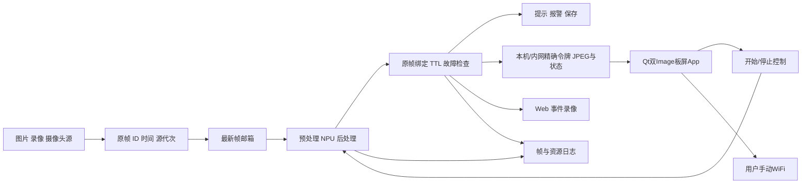

# RK3568安全帽检测开题PPT逐页内容与演讲稿

建议题目 基于RK3568的离线安全帽检测与状态闭环系统设计与评估

本稿2026-11-17修订，保持12页、约8分钟。采用既有模型，不训练/微调/剪枝/蒸馏；v6-r1完成精确二进制JPEG、双Image、180秒回放、常驻、LAN、完整退出和最终入口，v4/v5的物理全屏、拔线TTL与真实USB相机短跑按历史证据引用。长期现场、人工屏幕和独立质量仍有边界。题目、学校模板和个人信息待确认，旧实验按原SHA保留。

[HTML离线演示](../deliverables/开题演示.html)支持逐页、全屏和备注；[当前可编辑PowerPoint v7](../deliverables/开题报告-RK3568-v7.pptx)保留原生文字、表格和逐页讲稿，已通过Artifact Tool校验并导出全部12页预览。学校模板与姓名、学号、学院、指导教师仍需填写。

## 第1页 课题与研究范围

**页面正文**

基于RK3568的离线安全帽检测 与状态闭环系统设计与评估

现成YOLOv5社区模型的板端适配与系统评价

姓名、学号、学院、指导教师

**讲稿 约25秒**

各位老师好，我的课题围绕RK3568边缘设备上的安全帽佩戴检测系统。当前使用现成社区YOLOv5模型，研究板端适配、检测结果时效和部署评价，不开展模型训练或微调。接下来介绍课题要解决的问题、技术路线、前期实验和后续安排。

**依据** [当前工程范围](../superpowers/plans/2026-11-14-graduation-scope.md)、[开题正文](开题报告正文-建议稿.md)。

## 第2页 应用需求与问题边界

**页面正文**

- 单路输入，在板端识别裸头与戴帽头部，为人工巡查提供辅助提示。
- 板屏App直接开始/停止与看图，不需要板端浏览器或USB电脑页面。
- 空检测表示本帧未找到目标；故障或过期表示检测不可用。
- 真实USB相机、720×1280全屏和拔线TTL已有v4/v5证据；v6完成回放性能与常驻，物理现场另列。

**建议视觉** 使用项目真实检测预览图，注明“真实NPU录像回放”。不使用施工现场照片暗示已经完成现场试验。

**讲稿 约35秒**

本系统辅助安全帽佩戴检查，用户从开发板屏幕直接操作App，不依赖电脑页面。除了框，还要解释来自哪一帧、是否有效和事件能否回查。模型person表示裸头，两类都是头部；空检测不保证全员戴帽，中断需显示不可用。当前真实USB相机、全屏和拔线已经验证；systemui重载后的手指图标与独立供电仍单独验收。

**依据** [模型与流水线手册](../项目蓝图与完整手册.md)、[真实预览](../experiments/2026-11-14/web-board-preview.jpg)。

## 第3页 技术路线的选择

**页面正文**

| 路线 | 工作重点 | 本项目取舍 |
| --- | --- | --- |
| 自主轻量网络与训练 | 数据、训练、网络对比与泛化验证 | 超出当前不训练范围 |
| 现成模型的部署与评价 | 模型契约、系统行为、质量和性能实验 | 当前主线 |
| 云端推理与远程告警 | 联网服务、上传与云端运维 | 本地推理需求下不采用 |

课题贡献落在端侧工程实现与可追溯评价。

**讲稿 约35秒**

可以从网络设计、部署评价或云端服务三个角度开展这个课题。结合现有模型、板卡和已批准范围，我选择现成模型的离线端侧部署与状态评价。这样可以集中研究模型怎样正确运行、系统怎样保持结果新鲜、断流时怎样及时失效，以及效率与质量怎样取舍。题目弱化容易被理解为新网络设计的“轻量化”，直接突出离线检测与状态闭环。

**依据** [方向优化](2026-11-14-开题方向优化与陈述框架.md)。

## 第4页 研究问题与验证方法

**页面正文**

| 研究问题 | 验证方法 |
| --- | --- |
| 现成模型如何可靠运行在RK3568上 | 来源和哈希、输入与三检测头契约、真实NPU推理与失败测试 |
| 输入尺寸和量化如何影响质量与速度 | 固定诊断数据、六配置比较、同源416 FP16与INT8配对 |
| 异步检测如何提供及时且可回查的提示 | App开始/停止、原帧/TTL/代次、双Image预览与resident常驻，API/回放/正式入口分别评价 |

**讲稿 约40秒**

我将课题收敛成三个能通过实验回答的问题。第一个是部署正确性，检查模型来源、输入格式和输出布局，并验证非法输出能否被拒绝。第二个是配置取舍，使用固定数据和同源量化对照，避免把不同模型的差异归因于单一因素。第三个是系统时效性，验证异步处理中的结果绑定、过期抑制、报警和故障恢复，并保存可复核记录。

**依据** [精度报告](../experiments/2026-11-14/accuracy-results.md)、[量化报告](../experiments/2026-11-14/quantization-results.md)、[稳定性报告](../experiments/2026-11-14/stability-results.md)。

## 第5页 系统蓝图

**页面正文**

Qt板屏App通过本机服务开始/停止共用Pipeline。原帧ID、时间、源代次与TTL约束检测、预览和报警截图；预览使用精确 `frame_token` 与双 Image 二进制JPEG。WiFi由用户需要联网时手动操作。CLI Web/事件录像另保留，帧与资源日志贯穿检测路径。

**可编辑架构图内容**

**讲稿 约45秒**

Qt负责本地界面，127.0.0.1令牌服务负责开始/停止和对应帧预览，resident manager持有service与Qt。v6先请求小元数据，再让空闲Image直接加载精确二进制JPEG；新层就绪且原帧身份、源代次和TTL复查通过后才替换旧图。回桌面只隐藏窗口，检测继续；再次点图标复用同一session。WiFi是用户主动联网的另一后端，本地检测不要求外网。systemui重载后的手指图标与长期现场仍需验证。

**依据** [完整手册第3至6章](../项目蓝图与完整手册.md)、[App操作手册](../app/板端App使用手册.md)。

## 第6页 检测与报警的状态约束

**页面正文**

- 新鲜独立结果才参与持续报警判定。
- 同一结果重复显示不累计新的检测次数。
- 输入中断、过期或异常输出会抑制旧提示与保存。
- 恢复需要新源代次的真实检测结果。

前期故障覆盖推理异常、源中断、坏模型和坏源。

**讲稿 约40秒**

报警不是看到一个框就反复触发。状态机用新的独立结果积累持续时间，配置冷却和解除窗口。发生断流或过期时，旧结果不能继续作为健康输出，更不能继续保存为新事件。受控故障实验验证了这些规则和SDK清理，但源中断的安全边界从读取线程实际观察到失败开始，不能声称从人为宣告故障的一刻就有零延迟响应。

**依据** [故障终态](../experiments/2026-11-14/faultsuite-2/manifest.json)、[最终软件复审](../../.superpowers/sdd/2026-11-14-graduation-scope/final-project-rereview.md)。

## 第7页 数据与评价口径

**页面正文**

| 来源 | 图片 | 裸头GT | 戴帽GT |
| --- | ---: | ---: | ---: |
| SHWD固定子集 | 200 | 212 | 786 |
| HardHat固定子集 | 200 | 262 | 694 |

项目all-point AP50，分数下限0.001，工作置信度0.25，NMS 0.45。

训练重叠未知，来源间有一张已确认共同照片。当前结果仅作诊断比较，不能认证独立85%验收。

**讲稿 约45秒**

前期固定了两个各200张图片的来源子集。SHWD有998个目标，HardHat有956个目标。SHWD的139个difficult帽目标按普通目标保留，HardHat的35个全身人物框明确忽略，所以必须说明标签规则。指标采用项目AP50，不能称为官方COCO AP50到95。由于训练重叠未知、来源间也有共同照片，这些结果支持配置诊断，不足以证明独立场景的准确率目标。

**依据** [数据来源与许可](../experiments/2026-11-14/data-acquisition/SOURCE_AND_LICENSE.md)、[精度结果](../experiments/2026-11-14/accuracy-results.md)。

## 第8页 前期质量与量化结果

**页面正文**

| 既有模型 | SHWD mAP50 | HardHat mAP50 |
| --- | ---: | ---: |
| 原640 | 0.801844 | 0.823431 |
| 416×416 | 0.716366 | 0.792306 |
| 新640×640 | 0.801257 | 0.817045 |

同源416配对：FP16到INT8的处理均值118.49至64.43毫秒。

INT8的诊断mAP50下降0.85和1.12个百分点。配对模型与上表既有416模型哈希不同。

**讲稿 约45秒**

六个模型完成了两个来源上的12次完整板端评估。这里列出三个配置，原640的诊断mAP较高，416体现了质量和速度之间的取舍。另一个实验使用相同ONNX、相同尺寸和工具链构建FP16与新的INT8。INT8的预处理、推理和后处理总均值更低，但两来源mAP分别下降约0.85和1.12个百分点。它是短时顺序实验，还不能推广成所有场景或尾延迟的收益。

**依据** [准确率矩阵](../experiments/2026-11-14/accuracy-matrix-1/run-manifest.json)、[量化结果](../experiments/2026-11-14/quantization-results.md)。

## 第9页 原生App闭环：v6性能与历史物理证据

**页面正文**

| 实测项 | 结果 |
| --- | ---: |
| v6同条件回放 | 检测7.80 FPS、呈现4.40 FPS、Qt CPU 33.25% |
| v6 180秒回放 | 180样本，帧号39→3127 |
| v6常驻与清理 | 隐藏6秒帧号143→260，预览请求冻结；退出释放socket与lease |
| 历史物理证据 | v5相机180.50秒；v4正式入口196.67秒/帧号527→6312 |

v6回放使用416/responsive与单张图片输入；v4/v5分别提供物理全屏、拔线TTL和真实USB相机证据。30分钟固定10帧/秒回放另限v2单照片/20供给/显式日志。各run入口和时长不同，不能互相补齐。

**讲稿 约45秒**

本轮先解决预览热路径：旧base64 JSON改为精确二进制JPEG，双Image在新图就绪前保留旧图，同时合并重复状态写。相同回放条件下Qt CPU降到33.25%，180秒内帧号单调增长。隐藏6秒时检测继续而预览请求冻结，退出后真实清理。历史v4/v5再证明物理相机与屏幕路径；v6物理现场、长期连续显示、无泄漏和业务指标仍需验证。

**依据** [v6性能与运行报告](../experiments/2026-11-17/performance-baseline/report.md)、[v6常驻收据](../experiments/2026-11-17/performance-baseline/resident-lan-acceptance.json)、[中文30分钟报告](../experiments/2026-11-15/原生App30分钟验证报告.md)、[v4-r2 Phase 2终验](../experiments/2026-11-15/native-app-usability-v4-phase2-1/report.md)、[资源曲线](../experiments/2026-11-15/native-longrun-1-stability-v1/stability-results.json)。

## 第10页 原生App与离线交付

**页面正文**

- Qt本地App：全屏连续预览、检测开始/停止、回桌面常驻与WiFi密码键盘。
- 两个厂商入口、两个SVG、两个desktop和init已切到v6-r1，原cfg/入口备份可查。
- 正式入口已验证后台启动、会话切页、完整退出、lease释放与再次启动。
- 检测在板端离线运行；复制/更新使用完整ZIP，不依赖日常电脑连接。

同网手机可访问8091只读页面；状态使用精确令牌取JPEG，非法400、过期503。v6物理摄像头和实体手机未验。WiFi已实现状态、扫描和密码键盘；真实连接与systemui重载后的手指操作、独立供电仍待验收。应用包要求预装兼容Qt与RKNN环境。

**讲稿 约40秒**

App不需要浏览器，两个厂商入口已切到v6-r1并保留旧配置。正式入口启动新root，WiFi入口复用同一session，完整退出后才重新建立session。v6回放完成180秒，帧号39到3127；物理USB相机180.50秒与全屏/拔线证据来自v5/v4。systemui重启后的图标显示、真实WiFi认证和独立供电仍需现场完成。

**依据** [v6入口迁移](../experiments/2026-11-17/performance-baseline/entry-migration.json)、[v6入口验收](../experiments/2026-11-17/performance-baseline/entry-acceptance.json)、[v6发布清单](../experiments/2026-11-17/performance-baseline/bundle-manifest-v6-r1.json)、[历史v4图标迁移](../experiments/2026-11-15/native-app-usability-v4-phase2-1/formal-1/icon-migration-result.json)。

## 第11页 后续研究与验收安排

**页面正文**

| 相对周期 | 主要工作与交付 |
| --- | --- |
| 第1周 | 与导师明确题目、指标和现场条件，冻结配置及实验方案 |
| 第2至3周 | systemui重载后的图标手指检查、独立供电、WiFi与长期现场验收 |
| 第3至4周 | 采集有来源和场景信息的视频，建立事件标注，评价漏报警、误报警与延迟 |
| 第5周 | 联合质量与App/CLI各自组合长跑、吞吐、全进程资源/清理 |
| 第6周 | 完成论文、学校模板PPT、演示预案和可复核附件 |

日期按学校实际安排填写。设备或网络条件受限时，继续推进可独立完成的文档和评价工作。

**讲稿 约45秒**

先与导师明确题目和独立85%等条件。v6完成性能、180秒回放、LAN、常驻和清理；v4/v5保留物理全屏、拔线和真实相机证据。v6物理相机/人工屏幕、长期连续显示、资源、手指图标、独立供电、WiFi和现场事件继续验收。业务评价要有来源和事件标注，不能由框AP推算。

**依据** [当前范围](../superpowers/plans/2026-11-14-graduation-scope.md)、[开题正文](开题报告正文-建议稿.md)。

## 第12页 预期成果与讨论事项

**页面正文**

预期成果：可运行源码与部署包、模型来源和转换记录、数据与实验清单、质量及性能图表、完整操作手册、论文和现场演示。

工程贡献：模型契约、原帧时效、全屏常驻的Qt板屏应用、故障状态闭环与可追溯系统评价。

需要与导师明确：题目措辞、85%的指标与独立数据要求、10帧/秒的运行条件、现场与事件验收口径。

**讲稿 约30秒**

课题最终希望交付能运行、能解释结果、也能复核实验的系统。现有贡献集中在模型适配、原帧时效、常驻App与部署评价。85%独立质量、长期10帧/秒与现场业务目标仍有未完成条件，我会保留实测短板，依据正式实验继续完善。我的汇报到这里，谢谢各位老师。

**依据** [项目手册](../项目蓝图与完整手册.md)、[最新阶段总结](../experiments/2026-11-15/阶段总结.md)。

## 排练与现场准备

演讲按“需求与范围、研究问题、架构与方法、前期基础、后续计划”展开，避免逐行朗读指标表。主稿约8分钟，5分钟场合可压缩第3、6、8和10页说明，把原始实验与来源细节留作问答。保留85%与10帧/秒未达信息，不用展示刷新率替代检测吞吐。

现场准备本地演示文件、项目预览、事件录像及其元数据。使用回放时在画面和口述中说明输入来源。若网络或硬件不可用，展示本地材料并明确它是已记录实验。正式PPT使用学校模板制作，姓名等信息确认后再提交，演讲资料不自动发布到外部平台。

## 问答速记

**为什么不训练模型。** 当前课题范围和贡献聚焦系统设计与端侧部署评价，使用已取得的社区权重，不把模型训练写成自身成果。若学校要求算法训练贡献，需要另行调整课题和数据方案。

**创新体现在哪里。** 可描述为工程贡献：检测头契约、原帧绑定与源代次、结果过期抑制、报警留痕和可复核评估。算法层创新尚未建立，是否满足学校要求需与导师核对。

**85%达到没有。** 当前最高诊断mAP50低于0.85，训练重叠和场景独立性也未知，没有独立85%验收结论。某一类召回或单图置信度不能替代它。

**15 FPS与9.77 FPS为什么不同。** 前者是指定模型和输入下的短时预处理、推理、后处理均值换算，后者是30分钟整段回放的独立检测次数除以会话时间。输入节奏、日志、输出和调频等条件不同。

**当前是完全离线吗。** 原生App在预装兼容Qt/Linux/runtime后无需浏览器或电脑页面，本地检测可断网。v6-r1日常包与最终根已部署；复制/更新仍需完整包，U盘和无线OTA未实测。同网手机可选访问8091。WiFi由用户主动连接，实际认证/DHCP/保存、断USB供电仍待人工，包不是空白板OS镜像。

**App长期性能验证了吗。** v6-r1完成180秒回放、隐藏/复开、完整退出和再次启动；v4正式入口完成196.67秒、帧号527→6312的真实相机短跑；v2另有30分钟单照片回放。三者入口、输入与时长不同，不能互换。v6物理相机、长期连续显示、无泄漏和现场仍未验。

**浏览器显示真的测了吗。** 实际HeadlessChrome157有MJPEG load/visible和CDP隔离离线后的新load恢复记录，只作用于host浏览器，未改板端源或网络，不等于手机或人眼验收。

**摄像头现在验收到什么程度。** `/dev/video10`真实USB相机已用于v4/v5检测；v4记录连续预览和物理拔线后约100ms清空，v5完成180.50秒相机短跑。v6性能轮使用单张图片回放，没有补写物理相机结论。安装位置、长期供电和现场事件质量仍需实测。

**最终选哪个模型。** 416是性能候选，原640诊断质量较高。选型要结合裸头和小目标质量、完整系统吞吐、输出及稳定性，当前尚未定型。

**为何不宣称无泄漏。** +60秒后Python RSS增3.406MiB/OLS+.13012，Qt末差−1.551MiB但OLS+.45562MiB/min；末尾grab下降不能掩盖正趋势。共享RSS分进程，未设阈值/重复归因，单次曲线不证明无泄漏。
