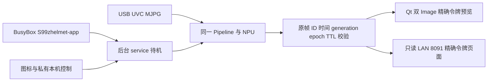
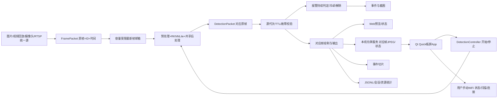

# 基于 RK3568 的离线安全帽检测与状态闭环系统

**项目蓝图与完整操作参考 · v6-r1 交付版 · 2026-11-17 · tag `native-app-v6-r1`**

本手册对应 v6-r1，是系统架构、算法契约、部署、使用和评估的完整参考。当前成果见[项目交付说明](项目交付说明.md)，第一次阅读按[阅读导航](阅读导航.md)进行。Qt 本地 App 是板屏入口，同一内网手机可通过 `http://板端IP:8091/` 查看；本地检测不要求外网或 USB 连接电脑。WiFi 由用户按需手动连接。

本轮 [v6-r1 报告](experiments/2026-11-17/performance-baseline/report.md)记录同条件预览性能、180 秒回放、隐藏/复开、双页切换、LAN 和完整退出。物理 USB 摄像头、板屏人工连续性、运行中拔线、实体手机、无人操作的自动后台开机、独立供电、WiFi认证和长期现场仍有限制。后文各历史版本保持原身份，不替代本轮未验项。

项目采用社区模型，范围继续**不训练、不微调、不剪枝、不蒸馏**。[批准范围](superpowers/plans/2026-11-14-graduation-scope.md)和原实验/复审记录保留历史状态；过期初步文档及原开题见[历史归档](archive/README.md)。本手册引用完整本地证据目录，`.superpowers/`、旧 ZIP、大视频和逐帧载荷可能仅存本机，GitHub 保存范围见[资料目录](README.md#github-与本机资料)。

## 目录

1. [当前交付与结论](#1-当前交付与结论)
2. [范围与验收口径](#2-范围与验收口径)
3. [当前架构](#3-当前架构)
4. [仓库与板端目录](#4-仓库与板端目录)
5. [模型与算法契约](#5-模型与算法契约)
6. [流水线、报警与 QoS](#6-流水线报警与-qos)
7. [环境与设备接入](#7-环境与设备接入)
8. [隔离部署与复现](#8-隔离部署与复现)
9. [当前 CLI](#9-当前-cli)
10. [物理摄像头与显示门槛](#10-物理摄像头与显示门槛)
11. [数据来源与转换](#11-数据来源与转换)
12. [精度评估](#12-精度评估)
13. [性能、回归与稳定性](#13-性能回归与稳定性)
14. [已知限制与排障](#14-已知限制与排障)
15. [交付状态与可选补验](#15-交付状态与可选补验)
16. [交付、论文与演示](#16-交付论文与演示)
17. [维护与实验记录](#17-维护与实验记录)
18. [证据与历史材料](#18-证据与历史材料)
19. [初学者阅读与实践路线](#19-初学者阅读与实践路线)

## 1. 当前交付与结论

### 1.1 交付状态概览

| 层次 | 已验证范围 | 保留限制 |
| --- | --- | --- |
| 核心流水线 | 原帧/结果绑定、独立计数、TTL、故障传播、受控退出、JSONL/会话统计；USB 真实采集与拔线 TTL 已验 | 其他物理源模式、长期驱动阻塞与现场延迟 |
| 报警与保存 | 新鲜独立检测的持续判定/冷却/解除；事件、定时与手动截图；故障和过期禁止复用旧提示 | 现场事件召回/误报警、实际声音可听性 |
| 原生App | v6-r1 二进制精确帧、双 Image、同条件检测7.80/呈现4.40 FPS、Qt CPU33.25%、180秒回放、隐藏/复开、双页和完整退出；主树435/15 skipped、legacy25/1 skipped | 物理摄像头、板屏人工连续性、拔线TTL、手指图标、独立供电、WiFi认证/DHCP与长期现场 |
| 手机与 init | 只读8091精确帧；板端WLAN地址与独立Windows主机HTTP200，非法400/过期503；resident与重启验收 | 实体手机、人工持续显示、无人操作的纯自动后台开机 |
| 其他输出 | Web/LAN JPEG与MJPEG、实际HeadlessChrome157加载与浏览器隔离断网恢复；真NPU报警前后各5秒MPP片完整 | 手机/人眼体验、真实摄像头事件与输出组合长期 |
| 精度 | 两个固定 200 图诊断来源×六模型，12 次真板 dump/eval 完整、哈希留档 | 训练独立性、充分场景覆盖、正式质量门槛 |
| 运行 | v6-r1 回放180秒/180样本、帧39→3127、检测8.08/呈现4.41FPS；v5相机180.50秒与历史v4/v2按原run引用 | 当前v6物理相机与1800秒未验；长期显示/内存判据保留 |
| 硬编/量化 | 同源416 FP16/新INT8真板质量/性能配对完成；受控硬编流水线CPU时间减少44.47% | 编码画质/码率不匹配、物理源长稳，不能从速度单独定型 |

### 1.2 当前六模型精度

来自 [accuracy-matrix-1 运行清单](experiments/2026-11-14/accuracy-matrix-1/run-manifest.json)。每来源 200 图，保留完整分母；AP 分数下限 `.001`，操作置信度 `.25`，NMS `.45`。数字为两类项目 all-point AP50，不是官方 COCO AP50:95。

| 模型 | SHWD mAP50 | HardHat mAP50 | SHWD 裸头 recall | HardHat 裸头 recall |
| --- | ---: | ---: | ---: | ---: |
| 原 `helmet-640-640.rknn` | 0.801844 | 0.823431 | 0.712264 | 0.858779 |
| `helmet_416x416.rknn` | 0.716366 | 0.792306 | 0.646226 | 0.828244 |
| `helmet_512x288.rknn` | 0.687700 | 0.760572 | 0.570755 | 0.793893 |
| `helmet_512x512.rknn` | 0.748804 | 0.818678 | 0.627358 | 0.832061 |
| `helmet_640x384.rknn` | 0.747638 | 0.789014 | 0.622642 | 0.820611 |
| 新 `helmet_640x640.rknn` | 0.801257 | 0.817045 | 0.688679 | 0.858779 |

`.802/.823` 对应原模型，不能误标为新 640。各类 AP/P/R/F1 与面积桶原值在每个 `*.metrics.json` 中。跨来源差值可以为正，不能预设都是“跨域衰减”。

两来源均为 prespecified 子集，训练重叠未知，且有一张已确认的共同照片。[严格配对结果](experiments/2026-11-14/accuracy-matrix-1/cross-source-comparison.json)为 `verified-pairs`、`independence=unknown`、`accuracy_target_pass=null`。最高 mAP 仍低于 `.85`；部分裸头 recall 大于 `.85`也不等于两类 mAP 或独立测试门槛通过。最终模型尚未选定。

### 1.3 短回放与历史速度

[11月14日短回放会话](experiments/2026-11-14/smoke-session.json)：416×416，`.25/.45`，请求回放 20 FPS、TTL `.5` 秒，运行 10.0865 秒，无显示。

| 会话量 | 实测 |
| --- | ---: |
| 成功采集 / 独立检测 / 输出 | 158 / 125 / 98 |
| 整段采集 / 检测 / 输出 FPS | 15.66 / 12.39 / 9.72 |
| NPU 推理均值 | 35.91 ms，125 次 |
| 采集到输出分发 p95 | 168.22 ms，98 次输出 |
| 采集到 sink 完成 p95 | 243.17 ms，98 次输出 |
| 显示计数 | 0 |

请求的 20 FPS 不是实际采集 20 FPS；sink 完成包含输出工作，但不包括浏览器渲染或传感器曝光。不能从短会话推断长跑、摄像头或所有输出模式都达标。

[2026-11-13 两轮静态性能报告](performance/2026-11-13-board-validation.md)仍作为历史对照：同场原模型处理 137.94 ms/7.2 FPS，416 候选 64.16 ms/15.6 FPS，512×288 为73.84 ms/13.5 FPS。该 E2E 仅预处理+推理+后处理，不含采集/显示/提示；不要与本次 AP 导出任务总时长混用。

### 1.4 板屏App与日常操作

从板屏“安全帽检测”进入，选模型、输入与 profile，点击开始；停止完成后再换配置。默认回放请求10FPS、responsive请求20FPS，不是实际采集/检测帧率。固定conf `.35`/NMS `.45`、skip0、TTL1秒。当前根为 `/userdata/helmet-validation/20261117-native-app-v6-r1`，入口固定为 `/opt/ui/src/apps/helmet_app`、`helmet_wifi`。

“回到桌面”隐藏窗口并保持检测，再点任一图标复用同一 session，只切页；“退出应用”请求真实清理。v6-r1 用416/`1.jpg`/responsive完成180秒回放，180样本帧`39→3127`，检测约8.08FPS、呈现约4.41FPS、Qt CPU约33.46%；常驻验收隐藏6秒帧`143→260`，预览请求计数`13→13`，同session/PID后正常释放。物理相机与人工屏幕连续性另列。

“无线网络”页提供状态、扫描、SSID和密码键盘；连接由用户点击，扫描不切换网络。历史只读扫描识别15个WPA2网络，真实认证/DHCP/保存/失败恢复仍待验。当前配置 BusyBox 后台待机及8091监听，不自动开始检测；厂商桌面的重载和手指操作由人工决定。

App 报警截图保存在隔离根 results 下。屏上没有参数编辑、日志导出、音量或MPP开关；完整输出实验仍按CLI另开新run。详见[App 手册](app/板端App使用手册.md)与[v6 手机/init指南](app/手机内网查看与开机启动-v6.md)。旧 Phase 1 闪烁/拔线结论由实际DRM时序支持，不转记为v6物理相机验收。

### 1.5 同一内网的手机接入与开机入口

手机连接可互通的同一 WiFi/内网，访问 `http://板端当前IP:8091/`；本板当前为 `http://192.168.1.3:8091/`。页内只查看状态与对应精确令牌帧；在板屏 App 手动开始检测。App 和手机共用一套摄像头/NPU及有效JPEG；退出应用后监听关闭，重新点图标或启动 init 才再次可访问。v6 LAN 热路径先完成 JPEG 解码再绘制 canvas，旧图不会因换图请求先被清空。



`S99zhelmet-app` 指向完整根内的 `src/app/autostart.sh`，`start/stop/status` 走 resident。重复 start 保持实例，stop 检查同会话收据、进程和锁。v6 已验收正常退出写入 `service_exit=0`、`cleanup_completed=true`、`resource_lease_released=true`，socket与三进程消失，并能重启新session。实际整机重启后的纯自动后台与实体手机仍需现场记录。

## 2. 范围与验收口径

当前工作是现成社区模型的边缘工程实现和诊断评价。**不以自主训练、新网络、剪枝或蒸馏作为本阶段成果或依赖**。量化校准与模型训练不同；新增配对转换必须固定同一 ONNX、工具链、预处理、输出裁剪和非评估校准输入。

| 指标 | 当前定义与限制 |
| --- | --- |
| 精度 | 明确项目 all-point AP50 和 score floor；独立性未证实时不判 `.85` 通过 |
| 检测速度 | 独立 frame ID 的有效检测数/会话时间；采集、输出、显示另计 |
| 时效 | TTL 使用原帧采集时刻；分发延迟和 sink 完成延迟分开 |
| 安全提示 | 只使用有效新鲜未戴帽证据；无检测/故障不能表示全员安全 |
| 稳定性 | 长跑终态、资源趋势和故障记录；进程暂时存活不是完整验收 |
| 现场 | 物理源、协商帧率、实际显示/声音、拔插和安装场景另测 |

学校对“85%”及正式场景/时长的定义仍需导师确认。既有诊断值、单图置信度或显示刷新率都不能代替该门槛。

## 3. 当前架构



该原帧/结果绑定和状态校验已经实现并经失败用例验证。当前没有身份跟踪；旧框不能迁移到新帧。输入读取成功后的应用时间戳不等于曝光时间。

App的LocalService只监听127.0.0.1并校验私有会话令牌，DetectionController持有Pipeline所有权。预览同时绑定run generation、source epoch、frame ID与原采集时间/剩余TTL；停止、失效和等待恢复隐藏旧图。Qt本地HTTP是App内部通道，日常操作无需浏览器。WiFi后端与检测分开，联网不是检测启动前提。

## 4. 仓库与板端目录

### 4.1 项目结构

```text
helmet/
  helmet_realtime.py    CLI与输出接线
  pipeline_runtime.py  Frame/Detection/Output包、邮箱、生命周期
  sources.py           图片、glob、视频、摄像头/网络源统一接口
  alarm.py             新鲜独立结果的报警状态机和有界音频进程
  telemetry.py         计数、计时、资源采样、JSONL和会话JSON
  output_sinks.py      HTTP预览/状态、事件切片与编码worker
  yolo_post.py         共享letterbox、YOLOv5 decode、分类NMS
  dump_dets.py          现有RKNN逐图导出及候选清理trace
  benchmark.py         固定条件处理测量
  validate_comparison.py 历史六模型性能完整性检查
  deploy.ps1/.cmd/.sh  检查型隔离部署
  app/                LocalService/DetectionController、WiFi、启动/图标安装
    resident.py       独立会话、单实例控制和清理监督
    lan.py            共用有效JPEG的只读内网页面
    boot.py/autostart.sh BusyBox后台启动与收据确认
    qml/Main.qml      Qt Quick检测/WiFi页与内置键盘
  pc/                 convert、dataset_tools、eval_map、analyze_errors
  models/、tests/     既有模型与输出/CLI/比较回归
tests/                 流水线、源、数据/评估/导出契约回归
models/source/         已核对来源ONNX；原模型/样图在models/
datasets/raw/          原始文件，不改写
datasets/provenance/   来源、选择、许可、坐标与重叠证据
datasets/evaluation/   shwd和hardhat固定200图规范化数据
docs/                  项目交付说明、阅读导航与完整技术手册
  app/                 当前 App 使用、常驻和整包更新资料
  proposal/            开题正文、陈述框架和逐页演讲稿
  deliverables/        当前 HTML 手册/演示和 v7 PPT 底稿
  experiments/         原始测量、manifest、阶段记录
  superpowers/         开发设计与计划历史
  archive/             旧初步文档、原开题、v3 指南和旧 PPT 原件
.runtime/、.venv/      隔离运行与转换环境，不属于模型训练成果
```

`tools_ai/ref/test.py` 为上游推理参考。仓库已有 Git 元数据并保存到 [GitHub](https://github.com/0tinna/helmet-detection-RK3568)；无中央构建系统，回归使用两套 unittest 目录。资料用途和本机/GitHub 保存边界见[资料目录](README.md)。

### 4.2 板端隔离目录

部署默认 `/userdata/helmet-validation/deployment/{src,repo,models,input,results}`；应用平铺`src/`及`src/pc`保持CLI兼容，另保留`src/legacy_tests`。完整测试镜像位于`repo/helmet`、`repo/helmet/pc`、`repo/helmet/tests`、`repo/tests`、`repo/docs/experiments/2026-11-14/verify_runtime.py`及requirements；主树从repo运行，legacy可从repo/helmet/tests或其平铺兼容目录运行。本轮历史根`/userdata/helmet-validation/20261114`，最终部署为独立`20261114-final`。每轮另建结果路径，不混写旧树。

历史 v2 根为 `/userdata/helmet-validation/20261115-native-app-v2`；[当时安装与独立运行](experiments/2026-11-15/原生App安装与独立运行验证.md)记录旧图标、默认 640 短配置和 lo UP child namespace。Phase 1 在这个板端验证副本临时改过文件，已偏离冻结 v2 SHA，详见其[临时偏差记录](experiments/2026-11-15/native-app-usability-v4-phase1-1/report.md)。该副本不作为当前整包部署身份。

当前根为 `/userdata/helmet-validation/20261117-native-app-v6-r1`。最终ZIP、SHA、两条App链接、两个desktop和init迁移收据由[2026-11-17报告](experiments/2026-11-17/performance-baseline/report.md)及发布清单记录。旧v5-r3根/ZIP、v4-r2根/ZIP和本轮候选根保留，不覆盖历史身份；`systemui`是否重载由人工决定。

## 5. 模型与算法契约

| 项 | 当前契约 |
| --- | --- |
| 模型 | YOLOv5 anchor-based，固定两类 |
| 类别 | `person(0)`=裸头；`hat(1)`=戴帽头部 |
| RKNN 输入 | RGB uint8，NHWC、batch1；mean0/std255在转换配置中 |
| ONNX 输入 | RGB NCHW float32/255，固定或显式核对尺寸 |
| 原输出 | `(1,3,gh,gw,7)`，7=框4+obj1+类2 |
| 裁剪输出 | `(1,21,gh,gw)`；三个stride8/16/32网格 |
| 预处理 | 等比缩放、114填充、BGR→RGB |
| 分数 | sigmoid(obj)×最大sigmoid(class) |
| NMS | 按类，默认IoU `.45`，max_det300 |

共享解码统一两种布局，矩形尺寸的 H/W 不能互换。源 ONNX 与基线 RKNN 的部署树/哈希关联已核对，五个旧转换变体的完整原校准谱系仍不应凭文件名推断。

Pipeline在共享解码前验证实际推理返回**恰好三个有限实数batch1检测头**，支持Conv `(1,21,gh,gw)`与legacy `(1,3,gh,gw,7)`，网格须匹配实际输入stride8/16/32、输入宽高为正的32倍数。缺/多/重复网格、非法布局和NaN/Inf均进入fault、无健康输出并释放资源；三个完整finite低分数头仍可表示有效空检测。unknown文件名的兼容尺寸回退也须通过实际网格核验，不能当成模型身份凭据；dump使用相同契约。新增验证成本计入post_ms，阈值/anchors/类别和解码数学保持原契约。YOLOv8/DFL或已最终解码输出不能直接替换。

规范化标注为零基半开 xyxy/COCO xywh。既有裁剪W-1/H-1会使完全位于padding的候选退化；dump出口清理有限零面积候选并保留类/分数/坐标/原因/数量，该几何修复没有改解码数学。最终版本又在共享解码入口加三头契约，不改变阈值/anchors/框数学；非有限、反向、非法类别/分数仍失败，外部非法detection文件拒绝。

当前 `judge_wearing` 使用两类头部冲突抑制：hat为戴帽，对person如存在IoU>`.3`的hat则抑制未戴帽警示。它不是全身人与帽子的身份关联算法，事件级准确性另验收。

## 6. 流水线、报警与 QoS

### 6.1 当前数据与生命周期

`FramePacket`携带原始 BGR、frame ID和采集时间；`DetectionPacket`保留同一原帧及检测阶段计时；`OutputPacket`携带绘制帧、检测证据、状态、报警和元数据。容量受限的最新帧/结果邮箱分别统计 consumed、detected、overwritten、active_skip、read_failure、output、displayed等，避免早期 Dropped 混义。

源代次变化使断流前的在途结果失效。TTL在分发、慢sink返回、提示和图像编码提交前等关键边界复查。故障/停机原因不被旧JPEG超时覆盖。工作线程在停止完成后释放其使用的engine/source；超时记录故障，不能提前释放忙碌资源。

### 6.2 报警与保存

报警依据独立、有效、新鲜的检测ID，使用单调时钟的dwell/cooldown/clear窗口；同一结果重复显示不累计触发。空检测、失效或断流使报警证据未知并重置连续窗口，恢复后重新积累。音频为一个有界、无shell的子进程，失败/超时写事件。

`--save-interval`已经实现，定期提交新鲜结果；`s`键也只保存新鲜结果。事件截图、frame ID、模型/输入/阈值、时间和故障元数据可追溯。保存/编码失败会传播，不能报告“保存成功”后没有文件。物理声卡音量与可听性仍需现场实测。

### 6.3 Web与切片

Web提供预览、MJPEG及状态JSON，消费原帧绑定输出；过期/故障清旧JPEG，连接失败释放client容量。页面在初始加载、重连pending与image error时隐藏图像，只有最新status有效且新load建立imageReady后显示；valid status不能把未到达的新图当作已恢复。恢复和受限error retry续订流，error立即隐藏。除JavaScript/DOM回归外，[真实HeadlessChrome157观察](experiments/2026-11-14/browser-current-3/browser-observation.json)记录MJPEG load、naturalWidth640、visible与fresh状态；[隔离浏览器恢复观察](experiments/2026-11-14/browser-current-3/recovery-observation.json)记录offlineHidden/recoveredVisible/freshLoadAfterRecovery=true。CDP离线仅作用于宿主浏览器，板端源和网络未改，不是物理断网、手机或人眼验收；未测试浏览器若不触发load仍会保守隐藏，staticJPEG fallback未实现。状态累计报警数不丢失。切片保留连续覆盖/断流/提前退出/编码失败，回放片不证明物理事件率。

### 6.4 计时口径

`capture_to_output_ms`截至回调分发；`sink_ms`为回调耗时；`capture_to_sink_complete_ms`截至sink返回。浏览器呈现、屏幕扫描和曝光延迟不在该值中。窗口FPS与完整会话统计并列；CPU进程百分比可超过100%，RSS/温度/频率不可得时为null，不能填零作测量。

### 6.5 默认有界统计与显式完整证据

未指定日志时，每个时延字段用Algorithm R保留至多2,048个样本，资源保留最近1,024条，时延/资源总计数及全样本时延均值精确。默认分位在未超容量时为`exact_linear`，之后为`uniform_reservoir_linear`并报告sample_count/capacity；不能称全样本精确分位或全资源数组。完整会话/滑窗FPS的计数口径不变。

指定`--jsonl`或`--session-json`任一参数即写完整帧/时延raw log与全部资源sidecar，并在运行目录旁使用临时磁盘spool。最终精确分位由disk-backed排序得到，标为`exact_linear_disk_spool`；live状态不做全量排序。session内resource list仍最多1,024条，`runtime_sample_retention`报告total/retained/raw_log，全部资源以sidecar为准。例如`--jsonl run.frames.jsonl`产生`run.frames.jsonl.resources.jsonl`；仅`--session-json run.session.json`产生`run.session.json.frames.jsonl`及其`.resources.jsonl`。原始日志exclusive新建，临时spool关闭删除，raw保留；磁盘用量/最终排序/page-cache随长度增长，不承诺任意长显式记录的固定RSS。

[软件堆复现](../.superpowers/sdd/2026-11-14-graduation-scope/final-project-rereview.md)处理100,000注入记录，保留695,195 traced bytes、六字段各2,048样本及1,024resource；这是软件边界证据，不是板端RSS/新30分钟无泄漏验收。原longrun-1用旧精确全列表保留，不追认其已使用此新默认策略。

## 7. 环境与设备接入

| 已归档环境 | 值 |
| --- | --- |
| 板卡/系统 | ATK-DLRK3568，4×A55，Linux5.10.160，aarch64 |
| 板端Python/OpenCV/NumPy | 3.10.5 / 4.5.4 / 1.21.2 |
| RKNNLite/C runtime/驱动 | 2.5.0 / librknnrt2.3.2 / RKNPU0.9.2 |
| 历史内存/eMMC | 约3.8GiB /58.3GiB；剩余量按现场读取 |
| 显示/媒体 | weston、fb/DRM、MPP插件及Qt Wayland短probe可查；现场人工视觉仍未确认 |
| Windows本地Python | `.venv/Scripts/python.exe` 3.10.22，隔离依赖可用 |
| Linux转换 | 工作区便携Ubuntu22.04 x86 VM；Toolkit2.3.2已可导入，转换仍按完成清单判定 |

原“Windows只有Store占位Python/没有Linux环境”是历史状态。当前不训练，隔离Linux只用于转换对照；同源FP16/新INT8已构建成功并完成同板配对。源ONNX已归档于 `models/source/helmet.onnx`，不是“尚未取得”。

```powershell
ssh rk "uname -a"
ssh rk "df -h /userdata"
ssh rk "v4l2-ctl --list-devices"
& ".\.codebuddy\tools\rk.cmd" "uname -a"
```

串口默认COM6/1500000baud、8N1，`RK_PORT/RK_BAUD/RK_TIMEOUT`可覆盖。设备换网后核对SSH别名/IP；私钥与WiFi凭据不放进仓库。

## 8. 隔离部署与复现

[deploy.ps1](../helmet/deploy.ps1)检查ssh/scp退出码，复制平铺应用与完整repo测试镜像、六模型/样图；compile/help、六source回归与模型hash通过才显示Verified。这不是主/legacy全树通过。`deploy.cmd`是包装，Linux `deploy.sh`保留相同两种布局。

```powershell
.\helmet\deploy.ps1 -Board rk -RemoteRoot /userdata/helmet-validation/demo-20261114
ssh rk "cd /userdata/helmet-validation/demo-20261114/src && python3 helmet_realtime.py --model ../models/helmet_416x416.rknn --source ../input --conf 0.25 --nms 0.45 --replay-fps 20 --result-ttl 0.5 --no-display --duration 10 --jsonl ../results/demo.frames.jsonl --session-json ../results/demo.session.json"
```

Linux等价部署：`sh helmet/deploy.sh rk /userdata/helmet-validation/demo-20261114`。每轮使用新日志和输出目录；默认隔离根 `/userdata/helmet-validation/deployment`不能代替独立结果版本。标准部署不自动传两套大型数据；评估数据需另行复制并校验。

完整回归须另行执行并归档版本/skip；主树的评估/图件测试也需分析依赖，缺matplotlib应明确为环境失败，不删相应测试或伪报全树通过：

```powershell
ssh rk "cd /userdata/helmet-validation/demo-20261114/repo && python3 -m unittest discover -s tests -v"
ssh rk "cd /userdata/helmet-validation/demo-20261114/repo && python3 -m unittest discover -s helmet/tests -v"
```

实验负责人串行使用NPU，记录调频前值并在结束/普通失败时恢复，读回确认。历史固定路径的 `run-board-comparison.sh`重跑前准备新实验目录，不能覆盖原结果；断电/SIGKILL不保证运行清理代码。

## 9. 当前 CLI

### 9.1 实时运行

| 参数 | 当前默认/含义 |
| --- | --- |
| `--source` | `/dev/video10`；目录、单图、glob、视频、摄像头/RTSP接口；默认节点不等于实际可用设备 |
| `--model` | `/userdata/models/helmet_640x640.rknn`；隔离部署运行应显式指向模型 |
| `--conf/--nms/--skip` | `.35/.45/0`；本轮对照显式使用 `.25/.45`，不擅自调整测试阈值 |
| `--cam-w/--cam-h` | 640/480请求值，现场核对实际协商 |
| `--replay-fps` | 10请求回放速率；不是摄像头FPS |
| `--result-ttl/--shutdown-timeout` | 1秒/2秒 |
| `--duration/--no-display` | 0持续运行；无显示也按时长退出 |
| `--save-dir/--save-interval` | 默认空/0；新鲜截图和定时保存已实现 |
| `--alarm-dwell` / `--alarm-cooldown` / `--alarm-clear` | `.5/10/1`秒；`--alarm-beep`启用音频，`--audio-timeout`默认3秒 |
| `--jsonl/--session-json` | 默认空：有界样本统计；任一显式日志启用完整raw/资源sidecar和最终精确磁盘分位 |
| `--stats-window/--sample-interval` | 5秒/1秒 |
| `--web-host/--web-port` | `127.0.0.1/0`，0关闭 |
| `--clip-dir/--clip-pre/--clip-post` | 空/5秒/5秒 |
| `--clip-fps/--clip-encoder` | 10，`opencv`；可显式选`mpp` |

`q/ESC`退出，`p`暂停/恢复，`s`保存新鲜结果。`--help`不需要初始化/导入RKNN包，实际运行才加载engine。

### 9.2 Web查看示例

板端在独立结果目录启动，启用 `--web-host 127.0.0.1 --web-port 8080`。另一主机终端：

```powershell
ssh -L 8080:127.0.0.1:8080 rk
```

浏览器访问 `http://127.0.0.1:8080/`。局域网直接访问需显式 `--web-host 0.0.0.0`，以实际网络验证为准。代码和本地HTTP回归通过，不宣称手机/现场屏显已经验收。

### 9.3 板端与PC评估

```text
python3 dump_dets.py --model ../models/helmet_416x416.rknn --data DATA_ROOT --out NEW_DUMP.json
python helmet/pc/eval_map.py --data DATA_ROOT --dets NEW_DUMP.json --out NEW_METRICS.json
python helmet/pc/analyze_errors.py errors --data DATA_ROOT --dets NEW_DUMP.json --confidence .25 --iou .5 --out NEW_ARTIFACT_DIR
```

`--onnx/--rknn-sim/--dets`已经互斥且必须选一个；sim需显式校准，读的是ONNX并重建模型，不代表旧RKNN文件。查看各工具 `--help`获取当前全部参数。比较CLI的 `--reference model=metrics.json`与`--external model=metrics.json`各重复六次；最小legacy指标必须显式允许且只能得到未验证诊断差值。

## 10. 物理摄像头与显示门槛

### 10.1 采集

先枚举实际设备，逐节点核对name/支持格式，再在选中的真实UVC/sensor节点测分辨率、像素格式、协商FPS和应用FPS。`/dev/video-camera0`、编码/解码节点、ISP空节点的存在本身不证明物理采集可用。

本次 USB UVC 为 `UNIQUESKY_CAR_CAMERA`（`1bcf:0b09`），`/dev/video10` 是 capture，`/dev/video11` 是 metadata。使用 **MJPG**：640×480 实际采集 90 帧/90 个不同像素 hash，后端报告 MJPG/30 FPS，见[相机接入记录](experiments/2026-11-15/摄像头到位与接入准备记录.md)。支持模式中的 30 FPS 与实际应用吞吐分开；不要选 rkisp 内部节点或 metadata 作为图像源。

```text
v4l2-ctl --list-devices
v4l2-ctl -d ACTUAL_CAMERA_NODE --list-formats-ext
```

文件回放与真实采集共用源接口，回放可验证状态、保存和故障逻辑。v4-r2已完成一次真实USB相机运行中拔线与1秒内失效验收；长期曝光、驱动缓存、独立供电和安装位置仍单独验收。

### 10.2 屏显与声音

CLI本地绘制使用OpenCV窗口，板屏日常入口使用Qt Quick原生App，Web是另外的远程输出。QT/weston/屏幕节点存在不保证SSH会话可显示；在有效图形会话中检查完整画面与框、真实触摸/键盘/滚动。App已有[检测内容截图](experiments/2026-11-15/native-app/detection-screen-final.png)和[键盘截图](experiments/2026-11-15/native-app/wifi-keyboard-screen-final.png)，它们不包括顶部header，也不证明人眼、断USB独立供电或声音可听性。未接入的硬件不以软件回归代替。

[display-probe.json](experiments/2026-11-14/display-probe.json)已归档Qt Wayland窗口读取图片、imshow、处理3秒事件和关闭的probe，退出0。可复用环境为 `XDG_RUNTIME_DIR=/var/run WAYLAND_DISPLAY=wayland-0 QT_QPA_PLATFORM=wayland`；原symlink runtime警告保留。它证明窗口API roundtrip，不证明人工看见板屏、物理摄像头画面或完整实时屏显验收。

v4-r2已用实际DRM输出验证720×1280全屏。Phase 1录屏300帧中预览空白帧0；运行中物理拔掉USB相机后约100ms清空，低于1秒TTL。Phase 2在真实`/dev/video10`上验证resident隐藏/唤回、双图标切页、完整退出和180秒短跑。结论来自实际合成屏幕与状态/帧号记录，不使用Qt`grabToImage`替代闪烁判断。

## 11. 数据来源与转换

### 11.1 固定来源子集与许可

| 来源 | 本轮实际数量/标签 | 选择与许可 |
| --- | --- | --- |
| SHWD | 200图，998GT：212裸头、786戴帽 | 原始test.txt的前200IDs；repo MIT不能推断全部图像MIT，SCUT-HEAD成分限学术研究，图像搜索素材权利不作无限再分发声明 |
| Kaggle `andrewmvd/hard-hat-detection` v1 | 200图，956GT：262head→裸头、694helmet→戴帽；35全身person明确忽略 | 原API列表前200个标注名，发布metadata为CC0；不是泛指任意Roboflow数据 |

选择在推理前固定，不缩小主集合以改善分数。来源总规模、完整ZIP转移与本轮200图的取得/评价范围分开记录。详细来源、原bytes/CRC/SHA和限制见 [来源与许可](experiments/2026-11-14/data-acquisition/SOURCE_AND_LICENSE.md)与两个evaluation manifest。

### 11.2 规范化规则

SHWD使用VOC一基包含端点：xmin/ymin减1，w/h加1。139 difficult帽目标由显式 `difficult_policy='include'`保留为普通GT，漏检正常惩罚；原flag与规则留档，**不是标准VOC difficult-ignore或官方SHWD基准**。

HardHat有143个原框从0开始，使用明确的零基边界解释：保留xmin/ymin，w/h为max-min；最大边界原源未明确文档，固定解释需要披露。全身person绝不映射成模型裸头。

七个SHWD声明名与原图扩展名/大小写不同：000034.jpeg、000182.JPEG、000222.jpeg、000251.JPG、000389.jpeg、000486.jpeg、000531.jpeg，均解析到同stem原 `.jpg`。`filename_policy='unique-stem'`显式开启唯一匹配，原名、实际名、原XML/image哈希保留，歧义失败；不改原图、不删图。

```text
python helmet/pc/dataset_tools.py voc --xml-dir XML_ROOT --images IMAGE_ROOT --class-map SOURCE_MAP.json --coordinate-mode voc-inclusive --difficult-policy include --filename-policy unique-stem --provenance PROVENANCE.json --groups GROUPS.json --out COCO_ROOT
```

HardHat单独选择 `--coordinate-mode zero-based --ignored-labels person`；来源map为 `head:0, helmet:1`。SHWD为 `person:0, hat:1`。CLI核对所有图的解码尺寸并拒绝覆盖已有原图。

### 11.3 场景与独立性

两个来源都没有可信camera/video/session/scene ID，各保留一个“scene unknown”诊断组。已确认 SHWD `000764.jpg`和HardHat `hard_hat_workers1137.png`为同一照片，后者缩放/反射padding；pooled分析必须共享该照片组。非相同byte hash不能证明独立。

场景/哈希组拆分工具已实现，但本轮不能伪造独立train/val/test。没有两个可信组件时拆分应失败。原模型训练manifest缺失，二来源之间也有照片重叠；统一报告诊断子集与未知训练重叠。

### 11.4 转换与量化边界

源 `helmet.onnx`已取得，固定部署commit、输入/原始检测头与基线RKNN哈希关联可查。隔离Ubuntu/Toolkit2.3.2环境和非评估校准样本准备已记录，CPU指令掩码造成的失败与重试也留档。

[正式配对构建manifest](experiments/2026-11-14/quantization/build/paired-build-manifest.json)为complete：同ONNX SHA、Toolkit2 2.3.2、416×416、输出Conv heads350/364/378、归一化及转换配置。FP16为15,411,133B，SHA `517fb9113337436f89a5129e62beb73156a37122bc1ffac57fd3349600b1ad45`；新INT8为8,110,065B，SHA `c93359dc2b13370b3e5619cf6c27826ccbc6056850dbb8f963cc523996239195`。100原SHWD train图仅作校准，固定诊断400图重复扫描未发现相同样本，不构成训练独立性认证。

[板端配对终态](experiments/2026-11-14/quantization-pair-1/run-manifest.json)归档两benchmark和四完整dump/metrics、源码/模型/结果哈希及governor恢复。各100循环FP16/INT8 infer为101.17/41.87ms、处理E2E118.49/64.43ms、8.4/15.5FPS；E2E是预处理+推理+后处理，未包含采集/显示/报警。SHWD mAP50为.718809/.710316（INT8−.8493个百分点），HardHat为.796636/.785472（−1.1164个百分点）；裸头/帽AP差值分别为SHWD−.5537/−1.1449、HardHat−.9719/−1.2609个百分点。新配对INT8与六模型矩阵旧416哈希不同，不混用历史指标；诊断独立性仍unknown。

[量化独立审计及图表](experiments/2026-11-14/quantization-results.md)核验两日志同图/尺寸、10次infer预热、历史源码snapshot和全量重算。benchmark图像哈希为事后读回，非运行当时stamp；FP16先于INT8，热条件/CPU频率未锁定，无逐loop原始时间或尾分布/重复会话，performance中间频率readback未保留。平均API/处理收益限定该短时顺序，不声明固定热条件或p95/p99收益。

`convert.py --fp`是不量化构建选项，不自动证明RKNN FP16能运行或量化损失。原模型与五个旧变体同时含工具链/图导出差异；ONNX CPU与NPU计时不能作为纯量化加速倍数。所有转换保持现成权重，不开展训练。

## 12. 精度评估

评估保留所有图，包括空图和缺legacy预测；未知-only/无可用GT数据失败。结构化dump必须完整，输入ID/尺寸/计数、汇总计数、运行状态、模型/图片/后处理hash、数据annotation/manifest身份、score floor/max_det和裁剪trace一致。失败推理不是空检测成功。

AP50为项目all-point插值，IoU `.5`，优先匹配可用同类GT；无GT类别AP/recall/F1为null，mAP只平均有GT类别。面积为source bbox：small `[0,1024)`、medium `[1024,9216)`、large `[9216,∞)`；其他面积GT仍可作为ignored匹配，不能直接删掉造成FP。

score floor `.001`为project-floor，仍不称full-score-range AP。高floor结果明确truncated，低于floor的错误图/工作点被拒绝；legacy覆盖未知。当前正式比较绑定六个distinct模型SHA，同pair输入尺寸/decoder/config/metric definition一致，来源内数据与class counts一致。训练独立性未证实，不能自动判85%通过。

TP绿、FP黄、FN红，含score/label/conf/IoU，样图选择按固定seed+filename hash。[正式素材复核](experiments/2026-11-14/figures/accuracy-verification.json)已重算12run metrics/areas/errors并确认相等，核验400 canonical图/raw annotation哈希；每run固定12样图和17张汇总图已生成，包含小目标、逐类曲线、跨来源和速度/质量取舍。

## 13. 性能、回归与稳定性

### 13.1 两套回归

```powershell
.\.venv\Scripts\python.exe -m unittest discover -s tests -v
.\.venv\Scripts\python.exe -m unittest discover -s helmet/tests -v
```

最新T5 fix2归档[主树](../.superpowers/sdd/2026-11-14-graduation-scope/task5-fix2-full.txt)129项=128通过+1平台symlink跳过，[legacy树](../.superpowers/sdd/2026-11-14-graduation-scope/task5-fix2-legacy.txt)23项=22通过+1未设`RK3568_TEST_MODEL`的NPU跳过，41任务自有测试通过。[最终独立复审](../.superpowers/sdd/2026-11-14-graduation-scope/task5-verification-rereview-2.md)重新复现无效资源覆盖/SDK收据负例并复核原始实验，scoped spec PASS/quality APPROVED。该软件批准不新增物理相机/显示证据，后续新测试以各轮日志为准。

随后打包任务归档[132项host回归](experiments/2026-11-14/offline-bundle-regression-1.txt)（131通过/1源码symlink权限跳过）和[23项legacy](experiments/2026-11-14/offline-bundle-regression-2.txt)（22通过/1NPU模型gate跳过），退出0；这些是其独立实际运行日志，本手册编辑没有重跑测试。

v4-r2在板端独立根完成当轮全仓回归：`Ran 399 tests in 139.731s; OK (skipped=13)`。新增原子替换竞态用例先RED后GREEN；真实摄像头污染静态输入fixture的问题通过测试内mock枚举隔离，产品枚举逻辑未改。

先前本地155/24和[board155缺fixture一skip](experiments/2026-11-14/full-tests-with-analysis.log)均保留，不能改写历史。补齐raw-head真实素材后[完整board主树](experiments/2026-11-14/full-tests-complete-fixtures.log)155/155无skip。板端legacy25项23通过/2缺Node JS skip，NPU模型gate启用；JS主机/独立复审通过，不能转成手机browser证明。两matplotlib环境失败保留，[隔离`.deps`](experiments/2026-11-14/analysis-deps.log)不改全局环境。[最终清单](experiments/2026-11-14/final-validation-manifest.json)与后续full-fixtures/longrun原始manifest分别留档。

### 13.2 11月14日Pipeline API长跑与历史对照

[当次稳定性报告](experiments/2026-11-14/stability-results.md)、[longrun-final manifest](experiments/2026-11-14/longrun-final/manifest.json)和[verification](experiments/2026-11-14/longrun-final/verification.json)绑定当次pipeline/telemetry/yolo SHA：Pipeline API、单照片录像循环、请求replay10、`.35/.45`、skip0/TTL1、显式完整日志与轻量回调，无App/Qt/Web/编码并发。active1800.068444秒、session1800.064616秒、actualenginecalls17,591、captured17,630、39overwritten、17,590output/1pending，无skip/read/infer failure/display。独立资源1760条maxgap1.162232秒；逐帧/资源/身份/库存strictcheck passedtrue。检测**9.772426970FPS**、输出9.771871434FPS、capture9.794092859FPS，未达10。

本轮显式diskspool、每时延livecap2048，六分位`exact_linear_disk_spool`；Pipeline资源total1781/summary1024，[raw sidecar](experiments/2026-11-14/longrun-final/frames.jsonl.resources.jsonl)含全部1781，与验证器独立1760样本分开。capture→dispatch p50/p95/p99=112.345/166.360/203.234ms，sink completion112.703/166.693/203.552ms，不是物理曝光/浏览器呈现。

active+60秒后的1700独立资源样本RSS首133,287,936B、末136,167,424B，增2,879,488B（2.746MiB），OLS1261.114B/s（.072162MiB/min）；首冷启动75,624,448B到末增60,542,976B包括SDK加载。温度最高62.777/58.333°C，采样NPU900MHz，before/after governor ondemand未强改。60秒是描述窗口，未设内存验收阈值/不保证warmup结束或无泄漏；直接cleanup未记录，verification仅间接normal-stop。该Pipeline API30分钟验证有界live统计加完整磁盘模式，默认无日志未做独立板端对照；它不证明App/显示/Web/编码或物理源组合长期运行。

[长跑manifest](experiments/2026-11-14/longrun-1/manifest.json)、[严格verification](experiments/2026-11-14/longrun-1/verification.json)及[图表分析](experiments/2026-11-14/longrun-1/plots/analysis.json)已归档终态：actual active interval1800.037977秒、captured17,600、17,559次真检测/输出、41capture overwritten，skip/read/inference failure/pending均0。1,756资源样本最大间隔1.122540秒，逐帧/资源连续性及数值/身份/库存严格校验通过。配置conf .35/NMS .45/skip0，capture9.777594、detection/output9.754817FPS、display0；**10FPS目标未通过**。

capture→dispatch p50/p95/p99=114.759/166.830/201.965ms，sink completion=115.122/167.126/202.267ms，不是浏览器渲染/摄像头曝光。RSS首样69,636,096B、终138,518,528B、峰139,259,904B，首尾增68,882,432B包括SDK启动加载；active开始后首样126,701,568B到终增11,816,960B。描述性地取active+60秒后1,695样本，首129,409,024B到终增9,109,504B，最小二乘斜率约4,635.49B/s（.265245MiB/min）。此60秒窗口不证明warmup已结束，也不是预设验收阈值；没有设内存增长门槛，不能声称无泄漏。

[输入manifest](experiments/2026-11-14/replay/manifest.json)是单照片生成的1200帧/10FPS/120秒录像循环；实际30分钟运行已另行验证，但不代表物理摄像头、场景多样性、屏显或带Web/编码的长期组合。原v1 runner未直接记录SDK释放，清理证据仍是正常停止的间接观察；snapshots目录不在原hashed core-log完整性范围。启动SSH关闭后[新SSH同PID/starttime观察](experiments/2026-11-14/longrun-1/ssh-observation.json)不等于物理LAN断网。

以上longrun-1旧曲线使用精确全列表，与当轮longrun-final分开保留，不回填源码身份或把差值全部归单一修复。longrun-final为当次核心代码显式日志模式提供30分钟证据；默认100k记录仅主机软件堆，不升级为板端默认无日志/无泄漏或原生App长期对照。

#### 13.2.1 11月15日直接清理烟测与App长期缺口

原生App新[native-smoke-4](experiments/2026-11-15/native-smoke-4/run-verification.json)使用v2服务SHA `9a2f7454db6fb48ebcf7f5fd301a831817374c2be2fc5c9036af60feb40df1f7`、既有416/录像回放、responsive20供给、完整日志/30秒截图配置和真Qt/本机服务，12秒134检测/133输出，11.123010861/11.040003318FPS、3次active HTTP200/可解码JPEG、native_gui_verified=true、直接SDK/source/worker/GUI/service清理accepted。该短配置10FPS达到，`thirty_minute_app_passed=false`，displayFPS未测；验证用私有QML wrapper直接调controller/service而未执行launch.py。旧smoke2无有效GUI图、smoke3 healthy间503均failed保留。

[预览并发修复复审](../.superpowers/sdd/2026-11-14-graduation-scope/native-preview-race-review.md)确认稳定包身份与旧reader缓存保护，失效/TTL规则不放宽。新服务23项22pass/1skip、[主树250项](experiments/2026-11-15/native-app/local-main-after-preview-fix.log)245pass/5skip、legacy25项24pass/1NPU skip归各日志；后续native-longrun-1已完成实际组合终验，旧v1代码/测试与短测限制不改写。

[receipts-smoke-1](experiments/2026-11-15/receipts-smoke-1/manifest.json)是新的schema2 Pipeline验证器12秒回放，既有416、construction-replay.avi、`.35/.45`/skip0/TTL1、请求replay20、governor before/after ondemand。active12.079689秒/session12.076230秒，232采集/151真检测/150输出/80覆盖/1待采集/1待输出，检测12.503902/输出12.421095FPS，display0。[派生验证](experiments/2026-11-15/receipts-smoke-1-verification.json)passed=true，direct_recorded/accepted=true；engine/source release、SDK收据与worker退出齐全，无shutdown_timeout。

旧API验证器将目标绑定replay20，烟测throughput_target_met=false保留；其短收据不回填旧longrun-final。新的native-longrun-1真实LocalService/DetectionController/Pipeline/RKNN/QML与HTTP/完整日志/30秒截图已经完成，见下一节；请求20与固定10目标仍分别报告，不能称摄像头20FPS或单一修复加速。

#### 13.2.2 原生App组合30分钟真实终态

[中文报告](experiments/2026-11-15/原生App30分钟验证报告.md)、[原manifest](experiments/2026-11-15/native-longrun-1/manifest.json)/[session](experiments/2026-11-15/native-longrun-1/session.json)/[cleanup](experiments/2026-11-15/native-longrun-1/cleanup.json)及[冻结严格验证](experiments/2026-11-15/native-longrun-1-verification.json)为completed/exit0/passed：active1800.051066469秒、session1800.049895689秒，34,496采集/19,806检测/19,805输出、14,689覆盖、1待采集/1待输出、零read/infer failure。检测11.0030283/输出11.0024728FPS、采集19.1639132FPS，固定10true/请求20false；360次active HTTP预览可解码，直接SDK/source/worker/HTTP/App/GUI清理accepted，Python8082/Qt8095均退出。

既有416、单照片construction-replay循环、responsive20、`.35/.45`/skip0/TTL1，controller/service+私有QML验证wrapper并未执行launch.py/厂商图标；完整JSONL、资源sidecar、30秒截图/QML5Hz预览/额外5秒HTTP，是验证负载而非默认无日志。采集→dispatch p95/p99=191.8008/254.9985ms，sink completion=244.6833/323.6640ms，不含Qt解码/物理呈现。running GUI采样3,443/3,601=95.6123%ready/visible，非连续可见时长/显示FPS；不可用样本保留。

[资源与曲线](experiments/2026-11-15/native-longrun-1-stability-v1/stability-results.json)分别报告Python/Qt。+60秒后Python RSS+3.40625MiB、OLS+.130122MiB/min；Qt首末−1.55078MiB但OLS+.455617，峰183.043MiB，末尾抓图/收尾附近下降不能掩盖正趋势。60秒描述窗口不证明预热结束，无泄漏阈值未设。thermal最高71.666/65.625°C，离散NPU900MHz、governor前后ondemand未锁频。共享映射可重复计入两个RSS，不相加称唯一内存。协调者[独立统计QA](../.superpowers/sdd/2026-11-14-graduation-scope/native-stability-root-longrun1-qa.json)确认519raw未改、24分布/窗口计数匹配。连续显示/无泄漏、独立85%/S1/S6及人工实物仍未验。

### 13.3 受控故障与恢复

[faultsuite-2](experiments/2026-11-14/faultsuite-2/manifest.json)父exit0，engine exception/source interruption/bad-model/bad-source四子项分别exit1/0/1/1、primary与直接cleanup全部通过；SDK监视器委托真RKNNLite并记录创建/释放收据。坏模型实际init_runtime拒绝46B损坏载荷并释放部分SDK；坏源在SDK创建前拒绝，合理空SDK收据有启动阶段证明。10次真检测后第11次worker消费注入raise，及74次源failed read后真实新epoch恢复，属于受控回放故障。

源失效以producer实际观察failed read并失效epoch为因果边界；其后禁止旧健康提示，恢复须真实读恢复后新epoch结果。suite2 reaction7.466903ms，不保证从宣告起0ms。[原suite1](experiments/2026-11-14/faultsuite-1/manifest.json)仍父failed/exit1、缺直接cleanup；原7.450530ms和frame10宣告窗口valid输出诊断失败保留。检测worker内raise用于验证故障目的，未做危险Python异步外杀线程；六模型分别启动及错误模型拒绝覆盖启动换模型，runtime hot-swap不是计划功能且未测试。相机拔插延期。

### 13.4 事件硬编与CPU对照

[最终真NPU报警切片](experiments/2026-11-14/event-clip-10s-final/event_1794645727089969634_conf0911_4a7f0947.json)为frame60报警、最大score .910921931、文件conf0911；MPP H.264100帧/10秒、前后各5秒complete=true、masked0、99 distinct sourceIDs、annotation hold≤.5秒。编码允许重复仍有效证据，encodedFPS不同于detectorFPS。[连续覆盖最终复审](../.superpowers/sdd/2026-11-14-graduation-scope/task4-codec-rereview-2.md)已批准；旧complete run的11mask及pre/post=false保留。实际相机事件仍待验。

[编码comparison2](experiments/2026-11-14/encoding-comparison-2/encoding-comparison.json)使用synthetic NV12 1280×720、300帧/30FPS、请求2Mbps：MPP CPU11.766183秒/wall11.230366秒，x264 ultrafast单线程CPU21.190024秒/wall21.150578秒，CPU时间减少44.473008%；两产物均独立解码H.264300帧/10秒。包含生成/转换/封装等成本，输出80,327/219,379B且画质/码率不匹配，不能当作纯编码器或任意相机场景收益。[早期短probe](experiments/2026-11-14/codec-mpp-probe3/)及失败实验全部保留。

### 13.5 Web与离线板端证据

[Web观察](experiments/2026-11-14/web-board-observations.json)在25秒真NPU回放中110次观察有87次状态/JPEG成功，启动拒绝/503留档。[LAN状态](experiments/2026-11-14/web-lan-live-server-probe.json)关联PID3017，宿主机三次status HTTP200、frame745/748/752及四项状态字段可见；附加curl exit127仅工具缺失。[最终LAN图像](experiments/2026-11-14/web-lan-preview-final.json)同一宿主脚本启动PID3057/30秒真NPU服务后取五张HTTP200、image/jpeg、可解码640×480×3的JPEG，再取MJPEG200、multipart boundary与JPEG首帧，SSH进程身份exit0。前后status frame推进，alarm_count0→1；[保存预览](experiments/2026-11-14/web-board-preview.jpg)有检测框/红横幅/frame14。证明host LAN服务和真实预览，不证明手机/浏览器排版与人眼体验；旧8次timeout和最终startup两次timeout仍保留，不改写成从未失败。

[原/v2禁网实验](experiments/2026-11-14/offline-network-isolated/manifest.json)完成77次真NPU，原/v2ZIP和manifest字节相同，证明当时3b7ad99a…sink及旧源码；这些文件不覆盖后来五项修复。新[final ZIP](../dist/helmet-offline-20261114-final.zip)为39,764,098B、SHA `480e7b1cc2c2f37697890e80d44defbc084275610506817043e3bed46853fb2b`，新manifest SHA `96c0b592b72773b4392f3bbb664a533a5bfc0b8725e3c040cbd7d21482a29e6e`。

[最终包禁网manifest](experiments/2026-11-14/offline-network-isolated-final/manifest.json)现已complete并核验上述新manifest：CLONE_NEWNET仅lo DOWN、host网络未改，verify/boardcheck/replay三命令exit0。[新session](experiments/2026-11-14/offline-network-isolated-final/session.json)10.068886秒、79真检测/78output/1pending、无read/infer failure/display，检测7.845952FPS、输出7.746636FPS，完整时延方法`exact_linear_disk_spool`，9资源记录的[sidecar](experiments/2026-11-14/offline-network-isolated-final/frames.jsonl.resources.jsonl)保留。它验证最终源码/NPU与显式证据路径，不是新30分钟稳定性或相机验收。[依赖说明](experiments/2026-11-14/offline-bundle.md)仍保留预装OS/runtime与fresh-install=false。

#### 13.5.1 原生App版本与历史lo UP禁网

当前版本见[v6-r1报告](experiments/2026-11-17/performance-baseline/report.md)及[版本管理](版本管理.md)。v6-r1 保留精确 `frame_token`、双 Image 无空档换帧、generation/source epoch/TTL 等保护，完成 180 秒回放、常驻、LAN、完整退出、最终整包和入口迁移验收。历史[v5-r3报告](experiments/2026-11-15/app-lan-autostart/report.md)与[v4-r2终验](experiments/2026-11-15/native-app-usability-v4-phase2-1/report.md)保持各自 SHA、物理相机与全屏拔线证据；它们不替代 v6 尚未补验的物理摄像头和人工屏幕项。

历史[安装与独立运行报告](experiments/2026-11-15/原生App安装与独立运行验证.md)记录当时4个owned链接/2个desktop迁移到v2、cfg不变/备份/无desktop重启或人工点击；actual wrapper→normal launch.py的默认640/1.jpg/replay10短回放与child CLONE_NEWNET仅lo UP验证均exit0、private clean、父网络保留。它支持当时的正常启动/断外网依赖短路径，不代替416/20供给30分钟，也不作为v4-r2禁网长跑证据。offline-1缺unshare未起App保留工具失败。

旧 WiFi wrapper 记录保留 wifi-1 未完成观察、wifi-2/3 操作失败或列表空；后端只读扫描与 WifiActions 有成功记录，原关联/IP 保持、无 connect。协议 trace 确认 v2 默认 8 秒等待短于实际 13.8725 秒扫描事件；v3 改为 20 秒并取得实际 UI 列表/键盘与 30 秒退出证据。v4-r2 保留此 WiFi 实现，真实连接/DHCP/保存仍未验，后续列表成功不改写旧失败。

[历史v3包](../dist/helmet-native-app-20261115-v3.zip)/[v3清单](experiments/2026-11-15/native-app/bundle-manifest-v3.json)为39,196,872B/28项载荷、6模型，SHA `a6ddec8f0d5579a62df261fc84a8f92cbce7b27c54ead79e9579f6e87e11058d`。[板端安装收据](experiments/2026-11-15/native-app/v3-installed-release.json)确认全部28项与封包一致。该版仅更新WiFi默认扫描等待和操作资料，service/Pipeline/QML/模型及当时图标目标未改变，安装根继续使用20261115-native-app-v2的历史目录名；v4-r2已取代其当前运行身份。

[历史v2包](../dist/helmet-native-app-20261115-v2.zip)与[v2清单](experiments/2026-11-15/native-app/bundle-manifest-v2.json)保持39,195,268B/28payload，SHA `f8957945cb90084f8c32cff789b07e0e4ca1c08690c493c5ed3593eacb4a4989`，v2的416长跑及旧8秒WiFi失败仍按原身份解释。

[历史v1包](../dist/helmet-native-app-20261115.zip)为39,192,392B/28payload，SHA `22585661da80c449fbf85ba65978ba851c73935819298ee2a5de48907824e679`，以[v1清单](experiments/2026-11-15/native-app/bundle-manifest.json)绑定旧service f602a639…。[v1终验](experiments/2026-11-15/native-app/validation-manifest.json)与[lo UP禁网](experiments/2026-11-15/native-app/native-offline.json)12秒demo exit0仅归v1，不能当v2禁网或长稳；旧CLI final不含App，其lo DOWN/79检测也保持原样。

App终验归档主机主树215项=211pass/4平台skip、legacy25项=24pass/1NPU gate skip，Linux WiFi34全pass及service20项=19pass/1Windows junction skip；平台/SDK boundary double范围见[11月15日总结](experiments/2026-11-15/阶段总结.md)。实际WiFi只读扫描/状态没有连接动作。App依赖预装兼容Qt/Linux/runtime，不是空白板镜像；人工触摸、独立供电和WiFi认证/DHCP/保存未验。

### 13.6 最终benchmark清理契约与短板端验证

公共benchmark在参数校验后保存governor原值、设置/读回performance，在finally恢复/读回原值；SDK创建后的load/init/inference/postprocess错误、可捕捉SIGINT/SIGTERM/HUP均走release finally，失败/恢复失败返回非零。保留成功列表`--json`兼容，`--manifest NEW.json`可独占写源码/输入/模型身份、三阶段raw loops、requested/completed、SDK清理及policy收据。SIGKILL、断电或不可中断nativecall不保证执行finally；不能把失败列表当成功对照。

[最终板端benchmark](experiments/2026-11-14/benchmark-final.json)及[raw manifest](experiments/2026-11-14/benchmark-final-manifest.json)已记录现416模型50loop/5warmup、infer42.2ms/post13.91ms/E2E65.87ms（15.2FPS），属于当前短时处理均值，不与旧量化pair混作单因素。公共benchmark保存/恢复原值均performance，符合契约；协调者随后[总调频恢复](experiments/2026-11-14/final-governor-restoration.json)明确before performance→after rknpu_ondemand、expected匹配verified=true，恢复实验原态。

## 14. 已知限制与排障

| 项目 | 当前结论与限制 |
| --- | --- |
| 物理采集与板屏/声音 | USB 枚举、MJPG 抓帧、DRM 全屏与拔线 TTL 已验；其他模式、长期现场与可听性未验 |
| 正式质量/85% | 当前最高诊断mAP低于.85且独立性unknown；报告限制，不调整测试阈值掩盖 |
| 最终选型 | 联合精度、小目标、真实吞吐/尾延迟、提示与长跑；416只是性能候选 |
| 长跑性能与资源 | 当前 v6-r1 完成 180 秒回放、GUI 检测/呈现计数和完整退出；历史 v5-r3 相机短跑、v4-r2 相机常驻及 v2 回放 30 分钟按原 run 引用。旧 API9.7724 未达、历史 Python/Qt 正 RSS 趋势保留，长期显示/内存判据未验 |
| 量化单因素 | 同源新FP16/INT8配对已完成；固定诊断集不认证独立85%，保留CPU-mask失败 |
| 完整硬编/CPU对照 | 真NPU回放10秒完整片和受控CPU对照完成；相机/画质匹配与长期组合待验 |
| LAN与手机 | v6-r1只读8091精确JPEG，板端WLAN地址与独立Windows主机HTTP200，非法400/过期503；实体手机和人工持续显示未通过；v5浏览器历史记录保留 |
| 原生App现场操作 | v6-r1完成常驻、双页复用、完整退出、init启动/停止和再次启动；v5相机短跑与v4物理全屏/拔线按历史证据引用，手指直接观察/独立供电/WiFi事务待验 |
| 当前版本离线交付 | v6-r1完整ZIP/清单/新root/两入口/init已核验，tag标记；U盘/OTA未实测，旧包SHA保持 |

排障先查证据：无图查真实设备而非默认节点；保存无文件查freshness/TTL/磁盘与事件；Web503查结果失效或故障而非复用旧图；检测FPS高而输出慢查sink计时/覆盖；dump失败查errors、rawheads和候选trace，不能评分失败文件。原图/原模型不为修饰指标而改动。

## 15. 交付状态与可选补验

### 15.1 当前维护状态

v5-r3 完成只读内网与开机入口后，本轮形成 v6-r1，tag `native-app-v6-r1` 绑定最终源码、资料和整包。v6 将预览热路径从 base64 JSON 改为精确二进制 JPEG，使用双 Image 保留上一张有效画面，并合并重复状态写入；同条件回放、180 秒回放、常驻、LAN、完整退出和入口迁移已验。物理摄像头与人工屏幕项仍按历史证据引用，9.7724FPS、独立85%、RSS趋势与长期现场限制保留。[版本与回退](版本管理.md)。

如论文或实际使用需要补充 systemui 重载后的手指图标、独立供电、WiFi 认证/DHCP、长期运行或事件质量，应另建实验记录。这些属于可选补验，不把早期训练设想或旧未勾选任务重启为本次开发要求。

### 15.2 状态与接受条件

| 里程碑 | 当前已达范围 | 保留接受条件 |
| --- | --- | --- |
| A采集可用 | 文件回放与真实 USB UVC/MJPG 抓帧已验 | 其他物理源模式、长期采集与安装环境 |
| B流水线可信 | 原帧绑定、TTL、故障与软件复审通过 | 现场源与输出组合验证 |
| C数据可追溯 | 两套固定诊断数据、映射/许可/hash齐全 | 真实独立性/场景证据不能伪造 |
| D应用闭环 | v6单实例、双Image、只读精确JPEG、最终init入口、重复退出与再次启动；v5相机短跑和v4物理全屏/拔线证据保留 | v6物理相机/人工屏幕、无人工提前开App的自动后台开机、实体手机、独立供电、WiFi与声音/事件 |
| E精度可比较 | 12次真板诊断评估完整、strict pairs | 不等于85%或官方benchmark通过 |
| F配置定型 | 有速度和质量候选表 | 所有质量/现场/稳定性门槛完成 |
| G稳定性 | v6-r1回放180.001秒/180样本/帧39→3127、常驻隐藏6秒帧号继续增长；v5相机180.50秒、v4相机与v2回放30分钟另引用 | v6物理相机180秒、当前App1800秒、连续显示/内存与长期现场未验，历史限制保留 |
| H交付 | 代码/当前 ZIP/GitHub 已保存，交付说明、手册、v7 PPT 与原件归档齐备 | 学校论文、模板和正式提交单独准备，未验项随交付列明 |

本表用于交付陈述；历史计划和 ledger 的勾选保留记录时状态。当前事实以[项目交付说明](项目交付说明.md)与对应终验为准。

## 16. 交付、论文与演示

论文主线为社区模型来源及端侧适配、可信流水线、诊断数据与精度、性能/QoS、故障与稳定性。训练章应改为模型来源/转换与校准，原训练目标以历史路线变更说明保留。引用数据子集、difficult/include、whole-person忽略、照片重叠和scene unknown，不能宣称自主训练或独立85%成功。

演示注明回放/物理源，板屏路径为图标→选择→开始/停止→原帧/截图，WiFi用户主动连接；CLI输出另述。[可编辑PPTX v7](deliverables/开题报告-RK3568-v7.pptx)保留12页、原生表格和逐页备注，作为版式与叙事底稿；[逐页稿](proposal/开题PPT逐页内容与演讲稿.md)及[HTML演示](deliverables/开题演示.html)已同步 v6 证据。学校模板/个人信息与完整论文仍需准备，题目/85%口径待导师。v6 已证明二进制预览、180 秒回放、常驻、LAN、清理和入口迁移；v4/v5 物理证据分开引用，长期现场、连续显示/内存、独立质量和真实WiFi另列。

## 17. 维护与实验记录

每轮保留模型/输入/标注/源码SHA、source与场景说明、运行命令、threshold/skip/TTL/报警/sink配置、依赖/runtime、计时边界、原始逐帧与资源记录、失败/恢复、退出码、governor前后值。输出使用新目录，成功与失败都留档。模型/数据版本改变后重新比较，不能拿不同条件结果拼成收益。

Python四空格、共享解码集中、类别顺序固定、串口ASCII。测试以真实行为和失败场景为准；图像渲染检查像素/可播放产物而非仅匹配源码文本。文档更新不重新执行实机实验；新终态由负责人补入精确证据路径与结论。

## 18. 证据与历史材料

- [最新11月17日性能与运行报告](experiments/2026-11-17/performance-baseline/report.md)、[发布清单](experiments/2026-11-17/performance-baseline/bundle-manifest-v6-r1.json)、[入口验收](experiments/2026-11-17/performance-baseline/entry-acceptance.json)和[主机回归日志](experiments/2026-11-17/performance-baseline/regression-host-v6-r1.log)。
- [11月15日阶段总结](experiments/2026-11-15/阶段总结.md)、[App30分钟中文报告](experiments/2026-11-15/原生App30分钟验证报告.md)/[严格验证](experiments/2026-11-15/native-longrun-1-verification.json)/[资源曲线](experiments/2026-11-15/native-longrun-1-stability-v1/stability-results.json)、[v2短测](experiments/2026-11-15/native-smoke-4/run-verification.json)、[v2实际发布清单](experiments/2026-11-15/native-app/bundle-manifest-v2.json)，v1终验/包保持历史。
- [v4-r2 Phase 2终验](experiments/2026-11-15/native-app-usability-v4-phase2-1/report.md)、[Phase 1终验](experiments/2026-11-15/native-app-usability-v4-phase1-1/report.md)、[v4-r2发布清单](experiments/2026-11-15/native-app/bundle-manifest-v4-r2.json)、[正式会话隐藏证据](experiments/2026-11-15/native-app-usability-v4-phase2-1/formal-1/hide-summary.json)、[180秒证据](experiments/2026-11-15/native-app-usability-v4-phase2-1/formal-1/longrun-summary.json)及[图标迁移收据](experiments/2026-11-15/native-app-usability-v4-phase2-1/formal-1/icon-migration-result.json)。
- [11月14日历史阶段总结](experiments/2026-11-14/项目阶段总结.md)、[准确率矩阵运行清单](experiments/2026-11-14/accuracy-matrix-1/run-manifest.json)、[严格配对比较](experiments/2026-11-14/accuracy-matrix-1/cross-source-comparison.json)。
- [真板短回放](experiments/2026-11-14/smoke-session.json)、[回放输入manifest](experiments/2026-11-14/replay/manifest.json)、[MPP短探针](experiments/2026-11-14/codec-mpp-probe3/)、[Qt Wayland短probe](experiments/2026-11-14/display-probe.json)。
- [真30分钟回放](experiments/2026-11-14/longrun-1/manifest.json)、[新故障套件](experiments/2026-11-14/faultsuite-2/manifest.json)、[量化配对终态](experiments/2026-11-14/quantization-pair-1/run-manifest.json)、[最终验收审计](../.superpowers/sdd/2026-11-14-graduation-scope/task-final-acceptance-audit.md)。
- [11月14日Pipeline稳定性报告](experiments/2026-11-14/stability-results.md)、[longrun-final30分钟manifest](experiments/2026-11-14/longrun-final/manifest.json)、[当轮155项完整夹具回归](experiments/2026-11-14/full-tests-complete-fixtures.log)、[HeadlessChrome加载](experiments/2026-11-14/browser-current-3/browser-observation.json)与[浏览器隔离恢复](experiments/2026-11-14/browser-current-3/recovery-observation.json)。
- [数据许可与来源](experiments/2026-11-14/data-acquisition/SOURCE_AND_LICENSE.md)、[SHWD manifest](../datasets/evaluation/shwd/manifest.json)、[HardHat manifest](../datasets/evaluation/hardhat/manifest.json)。
- [流水线实现报告](../.superpowers/sdd/2026-11-14-graduation-scope/task-1-report.md)、[流水线最终复审](../.superpowers/sdd/2026-11-14-graduation-scope/task-1-rereview-2.md)、[评估实现/fixround报告](../.superpowers/sdd/2026-11-14-graduation-scope/task-2-report.md)、[评估复审](../.superpowers/sdd/2026-11-14-graduation-scope/task-2-rereview-1.md)。
- [来源获取报告](../.superpowers/sdd/2026-11-14-graduation-scope/task-3-report.md)、[转换环境进行中记录](../.superpowers/sdd/2026-11-14-graduation-scope/task-3-conversion-report.md)：其早期状态以各后续更新和终态为准。
- [2026-11-13历史实测](performance/2026-11-13-board-validation.md)、[原开题](archive/early-proposals/开题报告.txt)、[早期阶段文档](archive/early-proposals/毕业设计-初步文档.md)。旧稿移入[归档索引](archive/README.md)，历史训练/待实现描述不再是当前工程状态。
- 上游：社区 [helmet_yolov5_rknn_deploy](https://github.com/harperjuanl/helmet_yolov5_rknn_deploy)、[Rockchip rknn_model_zoo](https://github.com/airockchip/rknn_model_zoo)、[SHWD](https://github.com/njvisionpower/Safety-Helmet-Wearing-Dataset)、[精确HardHat发布来源](https://www.kaggle.com/datasets/andrewmvd/hard-hat-detection)。

## 19. 初学者阅读与实践路线

先理解“什么模型、什么输入、证据在哪里”，再安装或改代码。离线可直接打开[HTML手册](deliverables/项目手册.html)；准备线下陈述看[12页逐页稿](proposal/开题PPT逐页内容与演讲稿.md)及[浏览器演示](deliverables/开题演示.html)。HTML不要求安装Office，也不意味着相机/实物演示验收完成。

独立操作先看[App手册](app/板端App使用手册.md)和[v6 手机/init指南](app/手机内网查看与开机启动-v6.md)。本地控制为127.0.0.1/私有令牌，手机只读为8091；板端不需要浏览器。U盘/SCP用于复制或更新，日常不要求电脑连接。当前包见[v6-r1清单](experiments/2026-11-17/performance-baseline/bundle-manifest-v6-r1.json)；实际整机重启、实体手机、手指操作和长期现场保留独立门槛。

当前 v6-r1 整包、完整新根、两条入口、两份 desktop 和 init 链接逐项一致，运行记录以[本轮报告](experiments/2026-11-17/performance-baseline/report.md)为准。native-longrun-1仍只属于v2显式组合的30分钟/固定10；v6回放、v5/v4相机、实体手机和现场接受条件不能互换。

| 顺序 | 阅读/操作 | 应能解释的结果 |
| --- | --- | --- |
| 1，认识范围 | [项目交付说明](项目交付说明.md)、本手册第1–2节、批准范围 | 使用社区模型，不训练；已交付功能与未验项分别陈述。 |
| 2，认识目录 | 第4–5节；模型provenance；`sources.py`/`yolo_post.py` | src用于应用、repo用于回归；person是裸头；三头/尺寸/阈值有契约。 |
| 3，理解一帧 | 第3/6节；`pipeline_runtime.py`、`alarm.py`、`telemetry.py`及对应tests | 原frameID/采集时间如何到输出；unknown/故障/TTL为何不能表示安全。 |
| 4，先做主机软件练习 | `.venv`运行CLI `--help`；test_sources与test_yolo_heads | 无RKNN也能检查CLI/源和head边界；这些不能当板端性能。 |
| 5，再做板端操作/回放 | App手册/原生包/图标更新；CLI实验另看第7–9节和checked部署 | 核对Qt/runtime/包SHA；板屏开始/停止与完整退出；分清回放、已验证USB相机和新设备。 |
| 6，读实验与论文材料 | 精度、量化、stability三个结果报告；第14–16节 | 区分项目AP、处理E2E、捕获到sink；9.7724FPS<10/85%未达，不先宣布最终模型。 |

建议第4步从仓库根执行以下两个小范围练习，不先更换模型或复跑NPU；读失败/skip原因后再进下一步：

```powershell
.\.venv\Scripts\python.exe helmet/helmet_realtime.py --help
.\.venv\Scripts\python.exe -m unittest discover -s tests -p test_sources.py -v
.\.venv\Scripts\python.exe -m unittest discover -s tests -p test_yolo_heads.py -v
```

当前实现的是**应用级离线运行**。判断“离线部署”时要区分以下层次：

| 层次 | 当前结论 | 已有证据 | 尚未覆盖 |
| --- | --- | --- | --- |
| 日常检测 | 可离线运行 | 板端模型、本机服务与历史真实USB相机证据；手机内网可选 | v6物理相机、长期现场供电与安装位置 |
| 应用更新 | 已验证完整包复制 | v6-r1 ZIP/manifest、全新root整体部署与逐文件核验；旧包保留 | U盘安装、无线OTA、无人值守升级 |
| 手机与启动 | 8091/init已配置并实测 | v6精确JPEG、入口迁移、init后台启动/停止与新session重启；历史Chrome解码/过期清除 | 实际整机重启、实体手机、持续显示无空档 |
| 板卡系统 | 依赖需预装 | 目标板已有Qt/Wayland、Python、OpenCV、NumPy、RKNNLite及驱动 | 空白板无网安装OS/runtime |
| 无线能力 | 扫描/输入界面已验证 | 真实SSID列表、密码键盘和手动连接UI | 目标网络认证、DHCP、保存与失败恢复 |
| 硬件闭环 | 短验已通过 | 720×1280全屏、连续预览、运行中拔线TTL、常驻复用、UI退出和196.67秒短跑 | `systemui`重载后的手指图标、独立供电、长期现场 |

因此，板卡启动后日常检测不需要持续连接电脑；更新仍需把完整包复制到新root，当前已验证SCP/复制路径。厂商系统或运行依赖损坏时，现有ZIP不能单独恢复整块板卡。

开题推荐题目为**《基于RK3568的离线安全帽检测与状态闭环系统设计与评估》**，对应板端离线运行、原帧新鲜度、故障抑制、常驻复用、完整清理和可追溯评价。研究问题、方向说明与学术提交安排见[优化陈述框架](proposal/2026-11-14-开题方向优化与陈述框架.md)，正式题目和日期由导师/学校确认。相对六周表用于提交与可选补验安排，代码继续按冻结版本维护。

v4-r2保留WiFi v3的20秒整体扫描/2秒命令默认。已有真实SSID列表与屏幕键盘记录，未发生真实目标网络连接。v4-r2的正式链接切换和180秒检测不证明WiFi认证、DHCP、保存或失败恢复；这些项目仍须在用户明确授权下现场测试。
